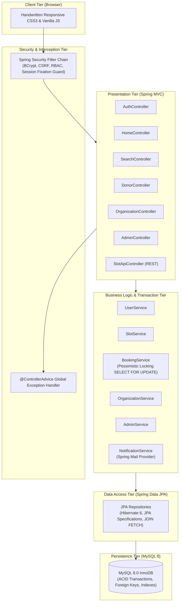
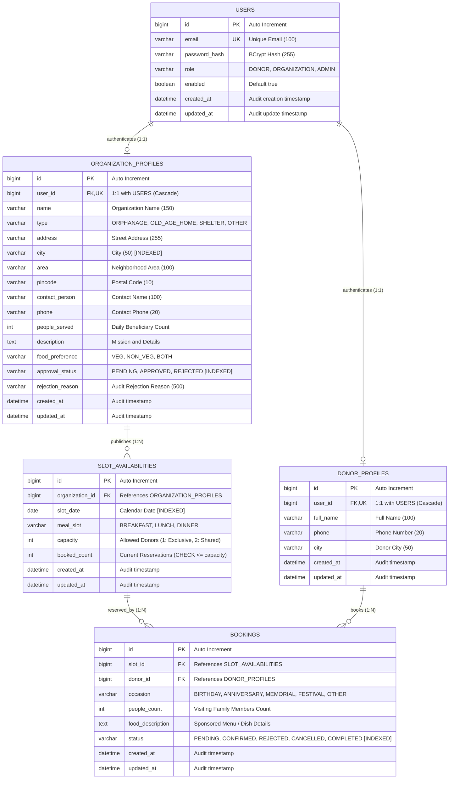

# AnnaSetu &mdash; Food Donation Slot Booking Platform

> **"Connecting Hearts and Bridging Plates"**  
> AnnaSetu is a production-ready, full-stack Spring Boot web application that connects donors looking to sponsor meals on birthdays, anniversaries, or memorial days with verified orphanages, elder care facilities, and community shelters.

---

## 1. System Architecture

AnnaSetu is built on a clean **layered architecture** (`Controller -> Service -> Repository -> Entity`), utilizing **Server-Side Rendering (SSR)** with Thymeleaf and Spring Security 6.



---

## 2. Entity-Relationship (ER) Diagram



---

## 3. Technology Stack

- **Backend Runtime**: Java 17 LTS, Maven 3.8+
- **Core Framework**: Spring Boot 3.2.4 (Spring MVC, Spring Data JPA, Spring Security 6)
- **Database Engine**: MySQL 8.0 (InnoDB dialect, utf8mb4 encoding, strict `ddl-auto=validate`)
- **Validation**: Jakarta Bean Validation (`jakarta.validation-api`, Hibernate Validator)
- **View Engine**: Thymeleaf (Server-Side Rendering, layout fragments, CSRF automatic integration)
- **Frontend Architecture**: **100% Pure Handwritten CSS3** (CSS custom properties, Flexbox, CSS Grid, mobile-first media queries) and **Vanilla JavaScript** (ES6+ Fetch API, DOM manipulation). *Zero Bootstrap, Zero Tailwind, Zero jQuery, Zero external UI bloat.*
- **Testing & Quality Assurance**: JUnit 5, Mockito, Spring Boot Test, `@DataJpaTest` slice testing, MockMvc security verification, Multithreaded Pessimistic Concurrency Test (`ExecutorService`).

---

## 4. Key Features

### For Donors
- **Multi-Dimensional Discovery**: Filter approved organizations by city, locality/pincode, institutional category, date, meal window, and dietary preference (`VEG`/`NON_VEG`/`BOTH`).
- **Interactive Live Slot Checker**: Dynamic vanilla JS calendar date picker querying availability via async Fetch API.
- **Pessimistic Concurrency-Safe Booking**: Guaranteed zero-overbooking even during peak festival rushes.
- **Self-Service Cancellation**: Permitted until 12 hours prior to scheduled meal time; automatically recycles reserved capacity for the community.
- **Official Print-Friendly Donation Receipt**: Dedicated certificate view styled via CSS3 `@media print` with verification stamp and zero browser UI chrome.

### For Partner Organizations
- **Institutional Profile Management**: Mission statement, capacity limits, dietary guidelines, and contact person.
- **Batch Slot Availability Engine**: Generate daily or monthly schedules across breakfast, lunch, and dinner with exclusive (1) or shared (2) donor capacity.
- **Daily Operations Spotlight**: "Today's Sponsored Meals" highlight card providing kitchen staff immediate access to today's menus and guest counts.
- **Chronological Calendar Agenda**: Grouped upcoming bookings schedule organized date-by-date via `TreeMap<LocalDate, List<Booking>>`.
- **Reservation Workflow**: Accept/Confirm bookings, reject and free up slots, or mark fulfilled as completed.

### For Administrators
- **Platform Analytics Console**: Aggregate metric cards tracking registered donors, total/approved/pending/rejected shelters, total slots, and booking statuses.
- **Institutional Verification Queue**: Review submitted documentation, approve shelters, or reject with mandatory audit explanation.
- **Live Platform Surveillance Feed**: Real-time audit stream of the latest 15 bookings with zero N+1 queries (`JOIN FETCH`).
- **User Account Access Governance**: Toggle user account active status with built-in defense against self-lockout.

---

## 5. Getting Started & Setup

### Prerequisites
1. **Java 17 JDK** or higher installed (`java -version`).
2. **Maven 3.8+** installed (`mvn -version`).
3. **MySQL 8.0 Server** running locally on port `3306`.

### Database Initialization
Create the database in MySQL:
```sql
CREATE DATABASE IF NOT EXISTS annasetu CHARACTER SET utf8mb4 COLLATE utf8mb4_unicode_ci;
```

### Configuration
By default, the application connects using standard development credentials (`root`/`root`). You can customize credentials by providing environment variables or updating `src/main/resources/application.properties`:
```properties
spring.datasource.url=jdbc:mysql://localhost:3306/annasetu?useSSL=false&serverTimezone=Asia/Kolkata&allowPublicKeyRetrieval=true&createDatabaseIfNotExist=true
spring.datasource.username=${DB_USERNAME:root}
spring.datasource.password=${DB_PASSWORD:root}
spring.jpa.hibernate.ddl-auto=validate
spring.sql.init.mode=always
spring.sql.init.schema-locations=classpath:schema.sql
spring.sql.init.data-locations=classpath:seed.sql
```

### Build & Run
```bash
# 1. Compile and execute all 109 automated tests
mvn clean test

# 2. Package into executable JAR
mvn package -DskipTests

# 3. Run the Spring Boot application
mvn spring-boot:run
```
The application will start at: **`http://localhost:8080`**

---

## 6. Pre-Seeded Demonstration Accounts

All pre-seeded accounts use the universal demonstration password: **`Password@123`**

| Role | Email Address | Password | Persona & Focus Area |
| :--- | :--- | :--- | :--- |
| **ADMIN** | `admin@annasetu.org` | `Password@123` | Platform Administrator & Verification Officer |
| **ORGANIZATION** | `ashakiran@annasetu.org` | `Password@123` | Asha Kiran Children Home (Pune) - Approved |
| **ORGANIZATION** | `snehasadan@annasetu.org` | `Password@123` | Sneha Sadan Senior Living (Mumbai) - Approved |
| **ORGANIZATION** | `karuna@annasetu.org` | `Password@123` | Karuna Care Shelter (Bengaluru) - Approved |
| **DONOR** | `rahul.sharma@example.com` | `Password@123` | Active Donor with upcoming & past bookings |
| **DONOR** | `ananya.deshmukh@example.com` | `Password@123` | Active Donor |
| **DONOR** | `vikram.mehta@example.com` | `Password@123` | Active Donor |

---

## 7. HTTP Route Table

| HTTP Method | URL Path | Access Authority | Description |
| :--- | :--- | :--- | :--- |
| `GET` | `/` or `/home` | Public | Landing page with hero banner, 3-step guide, and impact metrics |
| `GET` | `/search` | Public | Multi-criteria search page with live slot availability filtering |
| `GET` | `/organizations/{id}` | Public | Organization detail view with live date-picker and meal-slot buttons |
| `GET` | `/api/organizations/{id}/slots` | Public | JSON endpoint returning real-time slot availability for a date |
| `GET` | `/login` | Public | Form login page with CSRF token and alert banners |
| `POST` | `/login` | Public | Security authentication pipeline with role-aware success redirect |
| `POST` | `/logout` | Authenticated | Terminates session, clears remember-me cookie, redirects to login |
| `GET` | `/register/donor` | Public | Donor registration form |
| `POST` | `/register/donor` | Public | Processes donor registration and profile creation |
| `GET` | `/register/organization` | Public | Organization onboarding form |
| `POST` | `/register/organization` | Public | Processes organization onboarding (starts `PENDING`) |
| `GET` | `/donor/dashboard` | `ROLE_DONOR` | Donor dashboard: upcoming reservations, history, cancellation CTA |
| `POST` | `/donor/bookings` | `ROLE_DONOR` | Reserves a meal slot under pessimistic write lock |
| `POST` | `/donor/bookings/{id}/cancel` | `ROLE_DONOR` | Cancels reservation if >= 12 hours prior to slot |
| `GET` | `/donor/bookings/{id}/receipt` | `ROLE_DONOR` | Official print-friendly donation receipt (`@media print`) |
| `GET` | `/org/dashboard` | `ROLE_ORGANIZATION` | Organization console: today's meals, grouped calendar agenda |
| `GET` | `/org/profile` | `ROLE_ORGANIZATION` | Organization profile view & edit form |
| `POST` | `/org/profile` | `ROLE_ORGANIZATION` | Updates organization address, contact person, dietary rules |
| `GET` | `/org/slots` | `ROLE_ORGANIZATION` | Slot management console: calendar overview and batch adder |
| `POST` | `/org/slots` | `ROLE_ORGANIZATION` | Batch generates meal slots for date range and selected capacity |
| `POST` | `/org/slots/{id}/capacity` | `ROLE_ORGANIZATION` | Updates slot capacity (rejects if below current `bookedCount`) |
| `POST` | `/org/slots/{id}/delete` | `ROLE_ORGANIZATION` | Removes unbooked slot |
| `POST` | `/org/slots/block-date` | `ROLE_ORGANIZATION` | Blocks all slots on a date if no bookings exist |
| `POST` | `/org/bookings/{id}/confirm`| `ROLE_ORGANIZATION` | Confirms pending reservation |
| `POST` | `/org/bookings/{id}/reject` | `ROLE_ORGANIZATION` | Rejects reservation and frees slot capacity |
| `POST` | `/org/bookings/{id}/complete`| `ROLE_ORGANIZATION`| Marks confirmed meal sponsorship as completed |
| `GET` | `/admin/dashboard` | `ROLE_ADMIN` | Platform metrics, verification queue, surveillance stream |
| `POST` | `/admin/organizations/{id}/approve` | `ROLE_ADMIN` | Approves institution and enables user login |
| `POST` | `/admin/organizations/{id}/reject` | `ROLE_ADMIN` | Rejects institution with required audit explanation |
| `POST` | `/admin/users/{id}/toggle-status` | `ROLE_ADMIN` | Toggles user access status (with self-lockout guard) |
| `GET` | `/403` | Public | Custom styled 403 Access Denied view |
| `GET` | `/404` | Public | Custom styled 404 Not Found view |
| `GET` | `/error` | Public | Custom application error handler (no stack trace leakages) |

---

## 8. User Interface Highlights & Screenshots

```
┌────────────────────────────────────────────────────────────────────────┐
│                              AnnaSetu                                  │
│   Home    Find Meals    How It Works      [Login]    [Register]        │
├────────────────────────────────────────────────────────────────────────┤
│                                                                        │
│               Sponsor a Wholesome Meal on Your Special Day             │
│   Book food donation slots at verified orphanages, shelters, and       │
│   elderly care homes across India with instant confirmation.           │
│                                                                        │
│   ┌────────────────────────────────────────────────────────────────┐   │
│   │ [ Pune        ▼ ]  [ 2026-10-25 📅 ]  [ Lunch ▼ ]  [ Search ]  │   │
│   └────────────────────────────────────────────────────────────────┘   │
│                                                                        │
│   450+ Meals Sponsored   │   28 Partner Homes   │   3 Cities Active    │
└────────────────────────────────────────────────────────────────────────┘
```

1. **Responsive Mobile-First Interface**: Adapts fluidly across mobile phones (360px), tablets (768px), and widescreen desktop displays (1280px+).
2. **Warm Saffron Design Language**: Custom CSS design tokens establishing a dignified, warm aesthetic (`#d9531e` saffron, `#1b7a43` deep green, `#111827` slate).
3. **WCAG 2.1 AA Accessibility Compliance**: Semantic HTML5 markup, explicit `<label for="...">` associations, visible high-contrast focus rings (`:focus-visible`), and zero nested form errors.
4. **Print Optimization**: Clean donation receipt generation featuring receipt certificate border, verification code, and automatic browser header/footer suppression.

---

## 9. Automated Test Suite

Run the complete test suite with Maven:
```bash
mvn test
```
The project contains **109 automated tests** with **0 failures and 0 errors**:
- **Unit Tests**: Mockito-isolated business rule and state tests (`BookingServiceTest`, `SlotServiceTest`, `AdminServiceTest`, `CustomUserDetailsServiceTest`, `PlatformStatsServiceTest`, `OrganizationServiceTest`).
- **Data Access Tests (`@DataJpaTest`)**: Repository slice tests (`DataJpaRepositorySliceTest`) validating JPQL queries, deep `JOIN FETCH` operations, and derived repository methods.
- **Security MockMvc Tests**: Verification of Role-Based Access Control, custom login/logout pipelines, session fixation mitigation, and mandatory CSRF token rejection.
- **High-Concurrency Write-Lock Tests**: Multithreaded integration test (`BookingConcurrencyTest`) where multiple concurrent worker threads attempt to claim the final slot, proving pessimistic locking consistency (`bookedCount <= capacity`).
- **End-to-End Platform Lifecycle Test**: Full 10-step multi-persona integration test (`EndToEndLifecycleIntegrationTest`) verifying registration, vetting, slot generation, discovery, booking, shared capacity exhaustion, and cancellation recycling.
