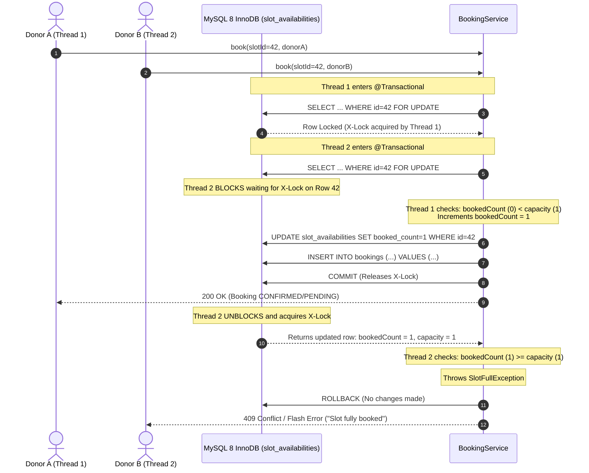

# AnnaSetu Concurrency Architecture & Locking Strategy

> **Core Problem:** When high-demand occasions occur (e.g., festivals like Diwali, Eid, Christmas, or auspicious weekend dates), multiple donors attempt to reserve the final available meal slot at the exact same millisecond. Without rigorous concurrency control, lost updates or race conditions would overbook the institution kitchen beyond its physical dining capacity.

---

## 1. Concurrency Invariants & Business Domain

AnnaSetu enforces strict business rules regarding slot capacity and booking integrity:
1. **Capacity Cap Invariant:** For any `SlotAvailability`, `bookedCount <= capacity` must **never** be violated.
   - Exclusive slots: `capacity = 1` (a single donor/family sponsors the entire meal).
   - Shared slots: `capacity = 2` (up to two independent donors co-sponsor the meal).
2. **Double-Booking Prevention:** A donor cannot book the same slot twice: `UNIQUE(slot_id, donor_id)` on `bookings`.
3. **Capacity Recycling:** When an active booking is cancelled by a donor (prior to cutoff) or rejected by the host organization, the slot capacity must be recycled atomically by decrementing `bookedCount`.
4. **Non-Cancellable Cutoff Window:** To safeguard food supply planning, cancellations are locked within 12 hours of the meal window (`annasetu.booking.cancellation-cutoff-hours=12`).

---

## 2. Pessimistic Write Locking (`PESSIMISTIC_WRITE`)

### Implementation
AnnaSetu employs **Pessimistic Write Locking** on the `SlotAvailability` entity:

```java
// SlotAvailabilityRepository.java
@Lock(LockModeType.PESSIMISTIC_WRITE)
@Query("SELECT s FROM SlotAvailability s WHERE s.id = :id")
Optional<SlotAvailability> findByIdWithPessimisticLock(@Param("id") Long id);
```

### Generated SQL in MySQL 8 InnoDB
When executed inside an active Spring `@Transactional` boundary, Hibernate translates this into:

```sql
SELECT
    sa.id, sa.capacity, sa.booked_count, sa.meal_slot, sa.organization_id, sa.slot_date
FROM slot_availabilities sa
WHERE sa.id = ?
FOR UPDATE;
```

### Execution Flow



---

## 3. Why Pessimistic Locking over Optimistic Locking?

A common interview inquiry is: *"Why did you choose pessimistic locking over optimistic locking with `@Version`?"*

### Comparison Matrix

| Architectural Criterion | Pessimistic Locking (`SELECT ... FOR UPDATE`) | Optimistic Locking (`@Version`) |
| :--- | :--- | :--- |
| **Locking Mechanism** | Database-level exclusive row lock (X-Lock). | In-memory version number comparison on update (`WHERE version = ?`). |
| **High Contention Behavior** | Serializes requests on the row lock; evaluating capacity sequentially. | All concurrent threads read successfully, but $N-1$ fail at commit time with `OptimisticLockException`. |
| **Failure Cost** | **Zero rollback overhead** for waiting threads: they read the fresh row, detect capacity exhaustion, and throw an immediate business exception. | **Massive wasted CPU/IO**: all $N$ threads execute application logic, prepare booking records, and then crash during the transaction commit phase. |
| **Client Retry Complexity** | **None.** Immediate deterministic answer: either you got the spot, or you receive a clear "Fully Booked" message. | Requires an exponential backoff / retry mechanism, causing "retry storms" under peak traffic. |
| **Inventory Scarcity Suitability** | **Ideal for scarce inventory** (slots with capacity 1 or 2, concert tickets, flight seats). | Better suited for high-read, low-write domains (e.g., editing user profiles or blog posts). |

### Interview Talking Point
> *"In food slot booking, meal slots are inherently scarce resources with a capacity of 1 or 2 donors. Under flash booking conditions (such as Diwali morning slots), 10 or 20 donors might click 'Book' simultaneously. With optimistic locking, 1 transaction would commit and 19 would abort with `OptimisticLockException`. If we implemented retries, all 19 would retry and compete again. With pessimistic locking, the first transaction holds the lock, increments the counter, and commits. The very next waiting transaction acquires the lock, immediately observes that `bookedCount == capacity`, and fails cleanly with a user-friendly `SlotFullException`. No retries, no deadlocks, and instant feedback."*

---

## 4. Transaction Isolation & MySQL 8 InnoDB Mechanics

### Default Isolation Level: `REPEATABLE READ`
MySQL InnoDB's default isolation level is `REPEATABLE READ`. Under standard `SELECT` statements, InnoDB performs **Consistent Non-Locking Reads** using MVCC (Multi-Version Concurrency Control) read snapshots.

However, a snapshot read is disastrous for capacity checking because a transaction would continue to see an outdated snapshot of `bookedCount`, leading to dirty writes.

### How `SELECT ... FOR UPDATE` Bridges MVCC and ACID
1. **Locking Read (Current Read):** `SELECT ... FOR UPDATE` forces InnoDB to bypass the MVCC snapshot and read the **latest committed physical state** directly from the clustered index.
2. **Index Record Lock:** Because our query filters by primary key (`WHERE id = :id`), InnoDB acquires a **Record Lock** on the clustered index entry (`PRIMARY`). It does **not** need to acquire Next-Key Locks or Gap Locks because the unique index entry unambiguously matches a single row.
3. **Deadlock Elimination:**
   - Deadlocks occur when transactions acquire locks on multiple resources in opposite order (e.g., Tx1 locks A then B; Tx2 locks B then A).
   - In AnnaSetu's booking pipeline, the acquisition order is strictly unidirectional:
     1. Lock row in `slot_availabilities` (`SELECT ... FOR UPDATE`).
     2. Insert record in `bookings` (foreign key to slot and donor).
   - Because all competing transactions request locks on the identical slot row in the identical sequence, transactions form a FIFO wait queue rather than a cyclical deadlock.

---

## 5. Cutoff Window Mechanics & Capacity Recycling

### The 12-Hour Cutoff Boundary
Organizations plan kitchen ingredients (vegetables, grains, dairy) hours in advance based on confirmed donor commitments. A late cancellation would leave the kitchen without food or with unmanaged surplus.

```
                  12-Hour Cutoff
Meal Start Time        |                  Current Time (Now)
=======================|====================================
12:30 PM (Lunch)   <-- 00:30 AM (Midnight)
      |                |
      |   LOCKED ZONE  |   PERMITTED CANCELLATION ZONE
      |<--------------|----------------------------------->
```

### Temporal Formula
```java
LocalDate slotDate = booking.getSlot().getSlotDate();
LocalTime mealStart = booking.getSlot().getMealSlot().getDefaultStartTime();
LocalDateTime mealDateTime = slotDate.atTime(mealStart);
LocalDateTime cutoffTime = mealDateTime.minusHours(cancellationCutoffHours); // default 12h

boolean isCancellable = LocalDateTime.now().isBefore(cutoffTime);
```

### Capacity Recycling
When a cancellation or rejection occurs:
1. `BookingService.cancel(bookingId, donorId)` or `rejectBooking(bookingId, orgId)` executes inside `@Transactional`.
2. It acquires a pessimistic write lock on the associated `SlotAvailability`.
3. It atomically updates `bookedCount = Math.max(0, slot.getBookedCount() - 1)`.
4. It updates booking status to `CANCELLED` or `REJECTED`.
5. On transaction commit, the slot capacity is immediately visible and available to other prospective donors searching the platform.

---

## 6. Verification: Multithreaded Integration Test

The multithreaded test suite is implemented in [`BookingConcurrencyTest.java`](file:///d:/yuvi/AnnaSetu/src/test/java/com/annasetu/concurrency/BookingConcurrencyTest.java).

### Test Architecture
- **Worker Pool:** `ExecutorService` with 10 concurrent threads.
- **Barrier Synchronization:** Two-phase `CountDownLatch` (a `readyLatch` ensuring all 10 worker threads are spawned and waiting, and a `startLatch` that fires all 10 simultaneously).
- **Independent Donors:** 10 distinct donor user accounts to isolate capacity contention from the `UNIQUE(slot_id, donor_id)` constraint.

### Verified Scenarios

#### Scenario 1: Exclusive Slot (Capacity = 1)
- 10 threads fire simultaneously for 1 spot.
- **Results:**
  - `successCount = 1`
  - `slotFullCount = 9` (cleanly caught `SlotFullException`)
  - `otherFailureCount = 0` (zero deadlocks, zero constraint violations)
  - Database row state: `bookedCount = 1`, `capacity = 1`.

#### Scenario 2: Shared Slot (Capacity = 2)
- 10 threads fire simultaneously for 2 spots.
- **Results:**
  - `successCount = 2`
  - `slotFullCount = 8`
  - `otherFailureCount = 0`
  - Database row state: `bookedCount = 2`, `capacity = 2`.

---

## 7. Senior Engineer Interview Q&A Cheatsheet

### Q1: What happens if the database connection dies while holding a pessimistic write lock?
> **Answer:** In MySQL InnoDB, row locks are associated with the transaction, which is tied to the physical database connection. If the client disconnects, times out, or the server detects connection loss, InnoDB rolls back the active transaction and immediately releases all acquired locks. Furthermore, MySQL has a configurable `innodb_lock_wait_timeout` (default 50 seconds) that prevents rogue queries from holding locks indefinitely.

### Q2: Could pessimistic locking cause performance bottlenecks under high global throughput?
> **Answer:** Pessimistic write locking only locks the specific **single row** (`WHERE id = ?`) being updated. In AnnaSetu, there are hundreds of distinct organizations and thousands of distinct meal slots across cities. Transactions for different slots run completely concurrently in parallel without interfering with one another. Contention is strictly localized to the specific slot record being booked.

### Q3: Why not rely solely on the database CHECK constraint `(booked_count <= capacity)`?
> **Answer:** Defensive engineering requires validation in depth. The database CHECK constraint is the ultimate safety net ensuring data corruption is mathematically impossible. However, letting threads violate the CHECK constraint results in unhandled `DataIntegrityViolationException` / SQL error codes, which surface as 500 Internal Server Errors to users. By checking capacity under a pessimistic lock in the service layer, we throw a domain-specific `SlotFullException` that translates into a clean, friendly 409 Conflict message in the UI.
