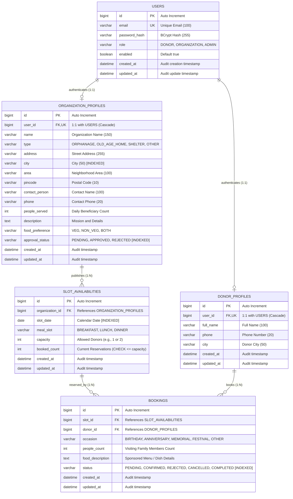

# AnnaSetu - Entity Relationship Diagram & Data Architecture

## Overview
**AnnaSetu** is an occasion-based food donation slot booking platform connecting donors with verified orphanages, old age homes, and community shelters.

---

## Mermaid ER Diagram

---

## Architectural & Interview Design Rationale

### 1. Database-First Integrity with `ddl-auto=validate`
- The application relies on `schema.sql` to explicitly define constraints, data types, indexes, and engines (`ENGINE=InnoDB DEFAULT CHARSET=utf8mb4`).
- Hibernate's `spring.jpa.hibernate.ddl-auto=validate` verifies at startup that the JPA annotations (`@Entity`, `@Table`, `@Column`, `@UniqueConstraint`, `@Index`) exactly match the physical database structure, preventing accidental data corruption or implicit schema mutations.

### 2. Normalization and 1:1 Persona Separation
- Rather than maintaining a monolithic `users` table with sparse, nullable columns, security credentials (`users`) are isolated from domain profiles (`donor_profiles` and `organization_profiles`).
- This allows custom role attributes (such as dietary rules and beneficiary counts for NGOs) to evolve independently without compromising donor accounts.

### 3. Concurrency & Constraint Safety
- **Composite Unique Keys**:
  - `slot_availabilities(organization_id, slot_date, meal_slot)` guarantees an institution cannot define duplicate meal slots for the same calendar day.
  - `bookings(slot_id, donor_id)` prevents the same donor from double-booking a slot.
- **Check Constraint**:
  - `CHECK (booked_count <= capacity)` on `slot_availabilities` safeguards against race conditions and overbooking at the database engine level.

### 4. Indexing Strategy for Fast Discoverability
- **`idx_org_city` on `organization_profiles(city)`**: Powers real-time search queries by metropolitan area.
- **`idx_org_approval` on `organization_profiles(approval_status)`**: Ensures only vetted and approved institutions appear on public discovery pages.
- **`idx_slot_date` and `idx_slot_org_date` on `slot_availabilities`**: Powers high-frequency monthly calendar and day-view queries without full table scans.
